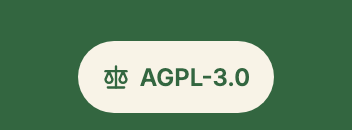
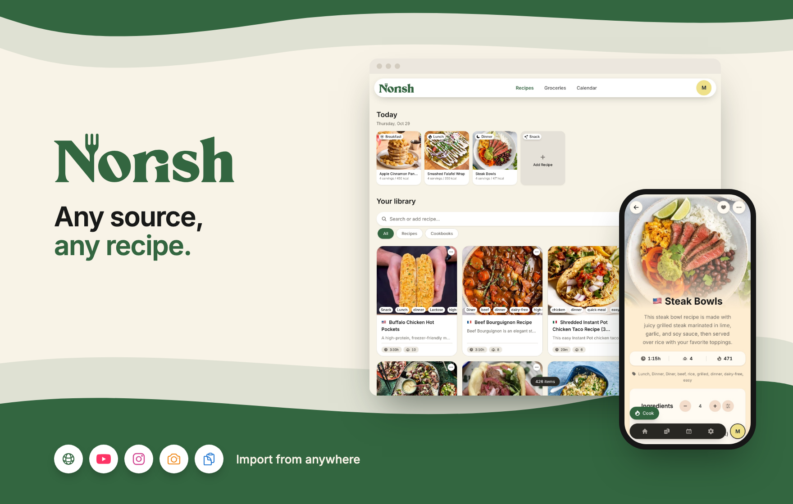
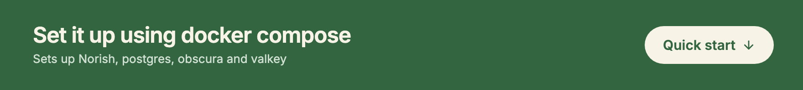
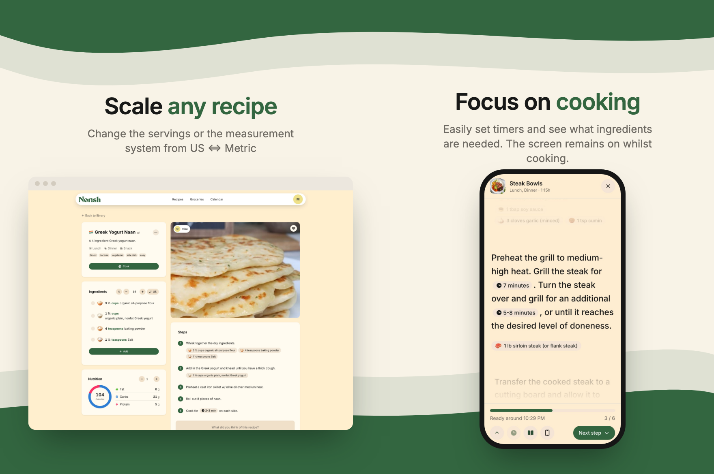
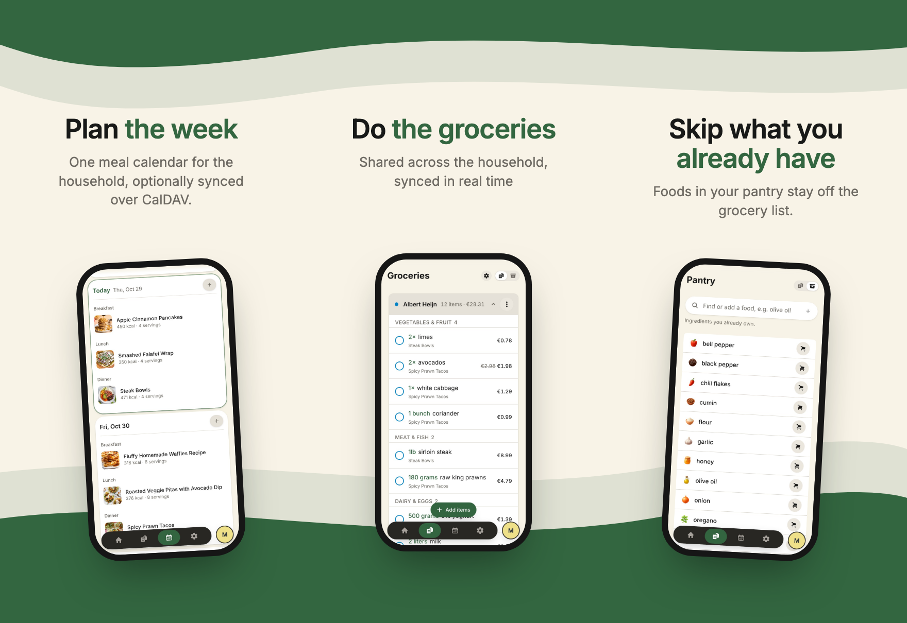
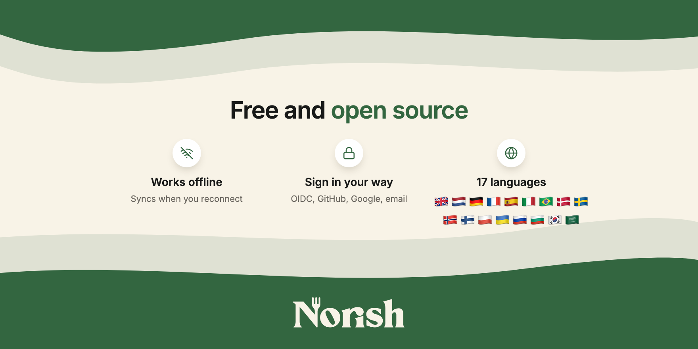
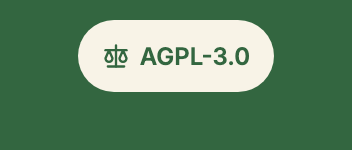
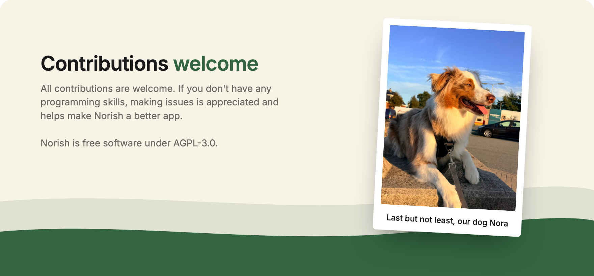

<p align="center"><a href="https://norish.dev"></a><a href="https://docs.norish.dev"></a><a href="https://github.com/norish-recipes/Norish/blob/main/LICENSE"></a><a href="https://hub.docker.com/r/norishapp/norish"></a><a href="https://buymeacoffee.com/mikevanes"></a><a href="#quick-start"></a><a href="https://norish.dev"></a><a href="https://docs.norish.dev"></a><a href="https://github.com/norish-recipes/Norish/blob/main/LICENSE"></a><a href="https://hub.docker.com/r/norishapp/norish"></a><a href="https://buymeacoffee.com/mikevanes"></a></p>

<a name="quick-start"></a>
<p></p>

Generate `MASTER_KEY` with `openssl rand -base64 32` and keep it stable: it derives the encryption keys.

```yaml
services:
  norish:
    image: norishapp/norish:latest
    container_name: norish-app
    restart: always
    ports:
      - "3000:3000"
    volumes:
      - norish_data:/app/uploads
    environment:
      AUTH_URL: http://localhost:3000
      DATABASE_URL: postgres://postgres:norish@db:5432/norish
      MASTER_KEY: <32-byte-base64-key> # openssl rand -base64 32
      OBSCURA_ENDPOINT: ws://obscura:9222
      OBSCURA_CDP_TOKEN: <random-token> # openssl rand -hex 32, same value on obscura
      VALKEY_URL: valkey://valkey:6379
      UPLOADS_DIR: /app/uploads
      
    healthcheck:
      test:
        [
          "CMD-SHELL",
          'node -e "require(''http'').get(''http://localhost:3000'' + (process.env.NEXT_PUBLIC_BASE_PATH || '''') + ''/api/v1/health/live'', r => process.exit(r.statusCode===200?0:1))"',
        ]
      interval: 1m
      timeout: 15s
      retries: 3
      start_period: 1m
    depends_on:
      - db
      - valkey

  db:
    image: postgres:17-alpine
    container_name: norish-db
    restart: unless-stopped
    environment:
      POSTGRES_USER: postgres
      POSTGRES_PASSWORD: norish
      POSTGRES_DB: norish
    volumes:
      - db_data:/var/lib/postgresql/data

  # Renders recipe pages for URL imports
  obscura:
    image: norishapp/obscura:0.2.5-norish.1
    container_name: norish-obscura
    restart: unless-stopped
    environment:
      OBSCURA_CDP_TOKEN: <random-token>

  valkey:
    image: valkey/valkey:9
    container_name: norish-valkey
    restart: unless-stopped
    volumes:
      - valkey_data:/data

volumes:
  db_data:
  norish_data:
  valkey_data:
```

<p><a href="https://docs.norish.dev"></a></p>

<p><a href="https://github.com/norish-recipes/Norish/blob/main/CONTRIBUTING.md"></a><a href="https://docs.norish.dev/development/setup"></a></p>
