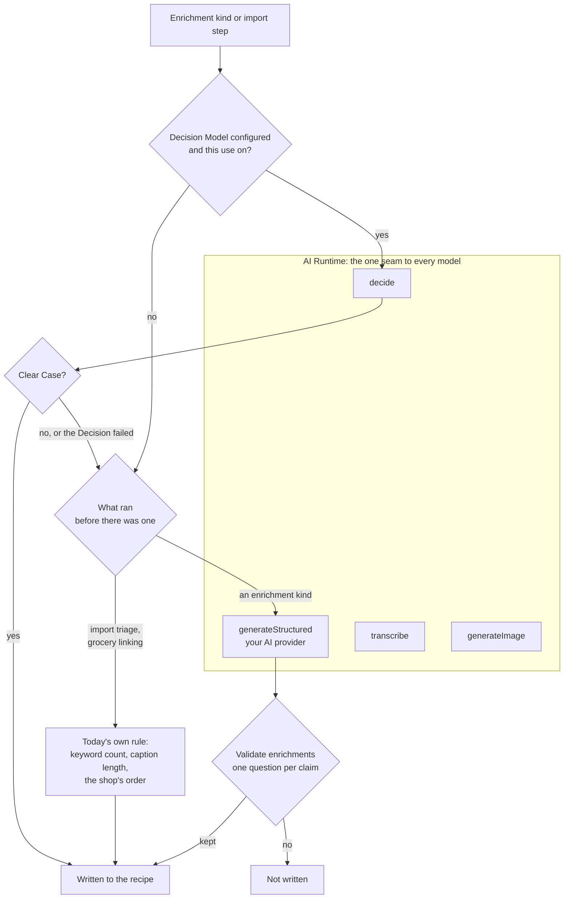

# AI provider

Several features are powered by AI. However most of Norish is functional without AI.
It's mostly used to make life a little easier.

AI enables:

- **AI fallback** When a recipe is not automatically detected by the [scraper](https://github.com/hhursev/recipe-scrapers).
- **Image import** From screenshots or photos.
- **Video import** For importing from different social media platforms (Instagram, YouTube...)
- **Recipe Enrichment**: Auto-tagging, allergy indications, categories, nutritional values, ingredient to step linking, and image generation.
- **Unit conversion** between metric and US units, as an alternative to the
  non AI conversion

## Enable AI via the environment

:::note
AI can also be enabled via the admin settings.
:::

Set `AI_ENABLED=true` and configure a provider. Any OpenAI compatible provider will work.
(OpenAI, Azure OpenAI, Open Router, a local Ollama/LM Studio server, …).

```yaml title="docker-compose.yml (environment)"
AI_ENABLED: "true"
AI_PROVIDER: openai
AI_MODEL: gpt-6-luna
AI_API_KEY: <your-api-key>
# For an OpenAI-compatible endpoint (Azure, OpenRouter, Ollama, …):
# AI_ENDPOINT: https://your-endpoint/v1
```

| Variable         | Description                          | Default      |
| ---------------- | ------------------------------------ | ------------ |
| `AI_ENABLED`     | Enable AI features globally          | `false`      |
| `AI_PROVIDER`    | AI provider                          | `openai`     |
| `AI_ENDPOINT`    | Custom OpenAI-compatible endpoint    | (empty)      |
| `AI_MODEL`       | Default model                        | `gpt-6-luna` |
| `AI_API_KEY`     | API key for the provider             | (empty)      |
| `AI_TEMPERATURE` | Generation temperature               | `1.0`        |
| `AI_MAX_TOKENS`  | Maximum tokens for model responses   | `10000`      |
| `AI_TIMEOUT_MS`  | Maximum time for an AI response (ms) | `300000`     |

## What an OpenAI-compatible endpoint has to support

Often times **structured output** is requested: This forces an answer in form of a JSON schema.
The strictest form is asked first:
(`response_format: json_schema`), and falls back on its own to plain JSON mode
(`response_format: json_object`), carrying the schema in the prompt instead.

An endpoint that does not obey to any of the above schemas is rejected.

## Recipe Enrichment

Recipe Enrichment is work that runs **after** a recipe is saved:
auto-tagging, allergy detection, auto-categorization, nutrition estimation*,
recipe provenance, ingredient linking, and image generation.

:::note
_\*When enough ingredients have nutritional values, the total calories are estimated without AI._
:::

### Automatic enrichment

Under **Settings => Admin => AI**, you can enabled/disabled the different enrichment types.

| Switch                   | What it does automatically                                                                | Default | Decision model Model                                       |
| ------------------------ | ----------------------------------------------------------------------------------------- | ------- | ---------------------------------------------------------- |
| **Auto-tagging**         | Adds suggested tags without removing existing ones                                        | Off     | Answers from the predefined list; checks every new tag     |
| **Allergy detection**    | Adds allergy tags for your household's configured allergies                               | On      | Answers, one question per household allergen               |
| **Auto-categorization**  | Sets meal categories on recipes that have none                                            | Off     | Answers, one question per category                         |
| **Nutrition estimation** | Estimates calories, fat, carbs, and protein when the recipe doesn't already have all four | Off     | Checks the estimate, logged only for now                   |
| **Recipe provenance**    | Works out the country, region, cuisines, and a short note                                 | Off     | Answers the country and Cuisines; checks every new Cuisine |
| **Ingredient linking**   | Links ingredient lines to the steps that have none                                        | Off     | Checks every new link                                      |
| **Image generation**     | Draws a picture of the dish for new recipes that have no image at all                     | Off     | Not used                                                   |

The Decision Model helps in multiple ways:

- **Answers**: the question is put to the [Decision Model](#decision-model)
  instead of the AI provider. It falls back to the AI provider when:
  it can't make a decision, it fails, it is off(duh), or it is not sure enough.
- **Checks**: the AI provider answers, any additions are put to the
  Decision Model before it is written.
- **Recipe Provenance**: the Decision Model always picks the country.
  In _Only existing cuisines_ mode it also picks the Cuisines from your list.
  When _AI can add new cuisines_ is on the AI provider suggests the Cuisines for the decision model.
- **Auto-tagging**: under _Predefined tags only_ the Decision Model picks from
  the tags listed under `PREDEFINED TAGS:` in the prompt.
  Under the other strategies the AI provider proposes the tags.

The [Job-queue](./admin-settings.md#job-queue) mentions what models are used.

### New ingredients

**Automatic for new ingredients** runs on every ingredient a recipe, grocery or pantry item adds
to the catalogue. Both options are off by default.


| Option             | What it does                                                                                                            |
| ------------------ | ----------------------------------------------------------------------------------------------------------------------- |
| **Clean the name** | [Cleans the name](../groceries/ingredients.md#cleaning-names) right away                                                |
| **Draw an icon**   | Draws an icon when the ingredient has none to show, not even its parent's. Needs an [image provider](#image-generation) |

### Existing data

Information you entered yourself, or that the source stated explicitly, outranks automatic enrichment.
The following rules apply:

- **Catorization**: Any meal detecxted category stops automatic categorization.
- **Nutrition estimation** When the source has a complete list of macros no estimation is run.
  On an incomplete list the estimation is run regardless. When the source matches nothing and Norish
  has more tan 80% of the database itself the macros are calculated without AI. With less than 80%,
  the facts Norish does have are sent to the provider to estimate the rest.
- **Recipe provenance** If the source states anything about this the run is skipped.
- **Ingredient linking** Ingredient linking is done per step line. Any lines you did yourself are ignored.
  [Step ingredients](../recipes/step-ingredients.md#letting-ai-fill-the-gaps).
- **Image generation** For most sources this will be skipped, if anything is present that will be used.
- **Tags and allergy indications** Are different: for these they append but
  never remove what is present.

_A run you request by hand is a deliberate refresh and does replace the current
categories, the complete nutrition group, or the complete provenance group._

### Tag strategy

**Tag strategy** decides which tags auto-tagging may use, independently of
whether it runs automatically:

| Strategy                       | Behaviour                                          |
| ------------------------------ | -------------------------------------------------- |
| **Predefined tags only**       | Only the built-in tag list                         |
| **Predefined + existing tags** | Also tags already used by recipes on this instance |
| **AI can create new tags**     | Creates new tags when needed                       |

### Cuisine strategy

**Cuisine strategy** decides whether provenance inference may add to the cuisine
list your administrator maintains, independently of whether it runs
automatically:

| Strategy                    | Behaviour                                           |
| --------------------------- | --------------------------------------------------- |
| **Only existing cuisines**  | Pick from the list; anything else is discarded      |
| **AI can add new cuisines** | Pick from the list, or add an entry that is missing |

Under both strategies the AI's answers are matched against the existing list
first, so a slight misspelling lands on the entry that already exists rather than
creating a near-duplicate. The list itself is managed under
**Settings => Admin => AI & processing => Cuisines**; see
[Recipe provenance](../recipes/provenance.md).

### Image generation


Image generation needs its own provider, because most AI providers dont have a generation model:
Anthropic, Mistral, DeepSeek, Groq and Perplexity don't provide one at all.

A self-hoster running a local text model can still point image generation
somewhere else, or at an Ollama server running an image models.
Configure it under **Settings => Admin => AI & processing => Image generation**:

| Field              | Notes                                                                                                    |
| ------------------ | -------------------------------------------------------------------------------------------------------- |
| **Image provider** | OpenAI, Google AI, Azure OpenAI, Ollama, LM Studio, or a generic OpenAI-compatible endpoint.             |
| **Endpoint URL**   | For Ollama, LM Studio and generic endpoints; optional custom resource URL for Azure                      |
| **API key**        | For the cloud providers                                                                                  |
| **Image model**    | Must be an image model, e.g. `gpt-image-1-mini`, `gemini-2.5-flash-image` or Ollama's `x/z-image-turbo`. |

When the image provider is the **same** provider as your AI configuration, the
endpoint and API key fall back to it.

The same image provider draws [ingredient icons](../groceries/ingredient-icons.md)
when someone uses **Generate with AI** in an ingredient's panel or **Draw icons**
on the Ingredients page, and for [new ingredients](#new-ingredients) when that is on.

### Decision Model


A decision model is a specialised model trained to do classification.
Norish can use these models to improve recipe detection on websites and
increase accuracy/validate output of the LLM provider. Currently only TypeSafe Jev
is supported.

Configure it under **Settings => Admin => AI & processing => Decision model**:

| Field                          | Notes                                                                                                                                                             |
| ------------------------------ | ----------------------------------------------------------------------------------------------------------------------------------------------------------------- |
| **Provider**                   | _Disabled_ or _TypeSafe AI_                                                                                                                                       |
| **API key**                    | From your TypeSafe AI account.                                                                                                                                    |
| **Model**                      | Defaults to `jev-latest` release                                                                                                                                  |
| **Use the decision model for** | _Auto-categorization_, _Auto-tagging_, _Allergy detection_, _Recipe Provenance_, _Grocery linking_, _Validate enrichments_. by default **Everything is selected** |

What it does:

- **Auto-categorization** is the recipe a: breakfast, lunch, dinner and/or a snack.
- **Auto-tagging** asks one question per predefined tag.
- **Allergy detection** asks one question per allergy.
- **Recipe Provenance** settles the country, and under _Only existing
  cuisines_ the Cuisines, by Decision and has the AI provider write the region
  and the note.
- **Import triage** **Not changeable** and always on with a Decision Model.
  Checks if the source contains a recipe.
- **Grocery linking** ranks the products the shop has in comparison to the grocery and links
  its pick when that is likelier than the alternatives.
  [Prices](../groceries/prices.md#which-product).

When _Validate enrichments_ is selected, everything an enrichment run **adds**
is checked before it is saved.

The below diagram explains the sequence.



### Run it on your whole library

Automatic enrichment only runs when a recipe is created, so recipes imported
before you enabled a switch, or before an enrichment kind existed, never
catch up on their own. **Settings => Admin => AI & processing => Bulk enrichment
=> Enrich all recipes** queues enabled enrichment.

**This action can be expensive.**


The confirmation also offers **Overwrite existing data**.

- **It cannot be undone, and it does not spare your own work.**
- **It costs more than the default sweep.**
- **Tags and allergy indications are never overwritten**

## Prompts


All prompts norish uses are customisable under the [admin settings](./admin-settings.md)

## Video import

Video import downloads the clip with `yt-dlp`, transcribes the audio, and uses
the AI provider to extract the recipe.

Links from YouTube, Instagram, TikTok, Facebook, Pinterest,
X, Threads, Snapchat, Vimeo, Dailymotion, Douyin, Bilibili, and
RedNote are recognised as videos.

| Variable                   | Description                                                              | Default                                   |
| -------------------------- | ------------------------------------------------------------------------ | ----------------------------------------- |
| `VIDEO_PARSING_ENABLED`    | Enable video parsing                                                     | `false`                                   |
| `VIDEO_MAX_LENGTH_SECONDS` | Maximum accepted video length                                            | `120`                                     |
| `YT_DLP_VERSION`           | yt-dlp release for development purposes (the Docker image ships its own) | `2026.08.19`                              |
| `YT_DLP_BIN_DIR`           | Folder containing the yt-dlp binary                                      | `./.runtime/bin` (dev), `/app/bin` (prod) |
| `YT_DLP_PROXY`             | HTTP/SOCKS proxy URL for yt-dlp downloads                                | (empty)                                   |

## Transcription

Transcription turns the video's audio into text.

| Variable                 | Description                                     | Default     |
| ------------------------ | ----------------------------------------------- | ----------- |
| `TRANSCRIPTION_PROVIDER` | Transcription provider                          | `disabled`  |
| `TRANSCRIPTION_ENDPOINT` | Transcription endpoint (local/custom providers) | (empty)     |
| `TRANSCRIPTION_API_KEY`  | Transcription API key                           | (empty)     |
| `TRANSCRIPTION_MODEL`    | Transcription model                             | `whisper-1` |

When the endpoint or API key is left empty, transcription falls back to the AI
configuration's endpoint and key.
