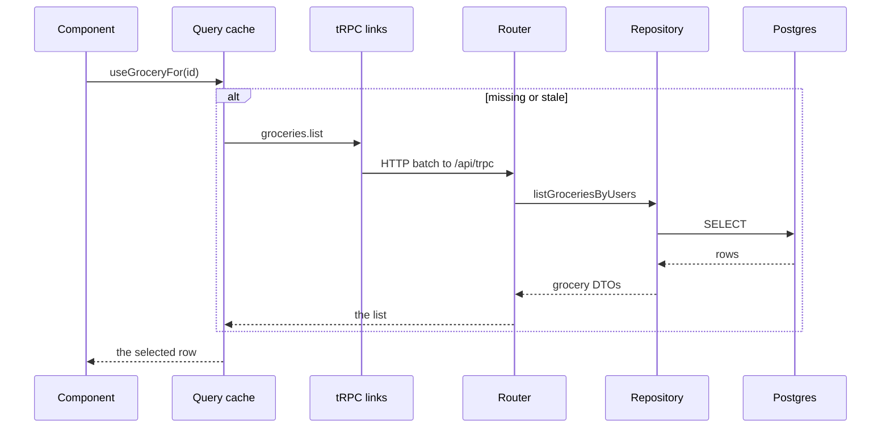
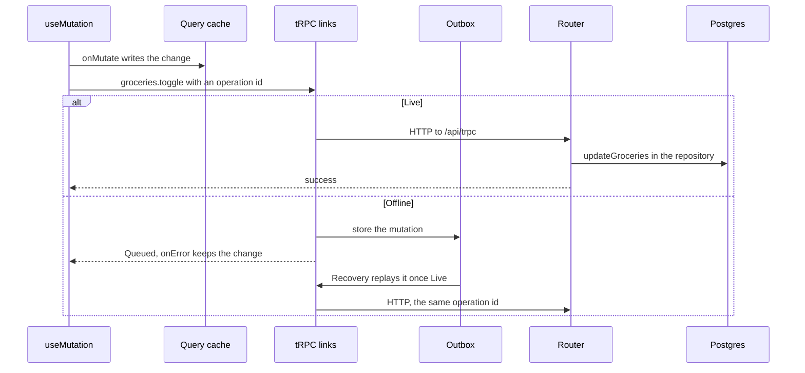
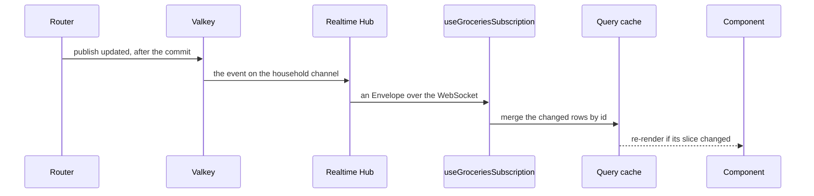

# Architecture

Norish is one Node server and two clients, a Next.js web app and an Expo mobile
app. The clients talk to the server through tRPC. Queries and mutations go over
HTTP, and realtime events over one WebSocket.

## Folder structure

```
norish/
├── apps/
│   ├── web/               # Next.js app, and the server entry in server/
│   ├── mobile/            # Expo app
│   ├── parser-api/        # Python service around recipe-scrapers
│   ├── docs/              # This site
│   ├── landing/           # norish.dev
│   └── quick-import-extension/  # Browser extension, a git submodule kept in its own repository
├── packages/
│   ├── api/               # Server startup, the import parser, CalDAV sync and video processing
│   ├── auth/              # Better Auth, sessions and permission checks
│   ├── config/            # Environment config and default reference data
│   ├── db/                # Repositories, migrations and the Drizzle client
│   ├── db-schema/         # Drizzle table definitions
│   ├── i18n/              # Locales and messages
│   ├── queue/             # Background jobs on BullMQ
│   ├── shared/            # Contracts and helpers that clients and server both import
│   ├── shared-react/      # React logic both apps share
│   ├── shared-server/     # Server logic several packages use: AI, realtime, ingredients, Valkey
│   ├── trpc/              # tRPC routers and the tRPC server
│   └── ui/                # Shared React components
├── tooling/
│   ├── eslint/            # Lint config, including the feature import rules
│   ├── prettier/          # Prettier config
│   ├── typescript/        # tsconfig files
│   ├── tailwind/          # Tailwind theme
│   ├── github/            # Composite GitHub Actions
│   ├── monorepo/          # Circular dependency and workspace import checks
│   ├── ingredient-icons/  # Draws the Ingredient Icons Norish ships
│   └── nutrition/         # Builds the nutrition source table
└── docker/                # Compose files and images
```

## What goes where

### In an app

Web and mobile use the same layout. Web keeps its folders at the root of
`apps/web`, mobile in `apps/mobile/src`.

- `app/` holds the route files, which render screens from features. On web a
  route file also does the server-only work: seeding the cache, metadata and
  params.
- `features/<feature>/` holds one domain's screens, components, hooks and
  helpers. Each feature is a domain: `library` (with the cookbook page),
  `recipes` (with the shared recipe page), `groceries`, `calendar`, `imports`,
  `settings` and `auth`.
- A feature groups its `components/` by area. An area's `index.ts` re-exports
  only pieces more than one screen draws; import a piece one screen draws by
  file, and omit the index when nothing is shared. The bundler ships every file
  an index re-exports, so mixing pieces puts one screen's code in another's
  chunk. Groceries has `header/`, `list/`, `panels/`, `pantry/` and `stores/`.
  Recipes has `page/`, `share/`, `editor/`, `read-only/`, `media/` and
  `skeleton/`. Library has `grid/`, `header/`, `filters/`, `selection/`,
  `panels/` and `skeleton/`. Skeletons, `loading.tsx` files and the shared
  recipe page import files directly.
- Features never import each other. Lint blocks `@/features/<x>` and
  `@/features/<x>/**` outside feature `<x>`, except in route files. Panels
  several features open live in `components/Panel/consumers/`.
- A feature's tests sit in one flat `features/<feature>/__tests__/` folder.
- One root draws the views that share a layout.
  `app/(app)/groceries/layout.tsx` renders `GroceriesRoot`, which holds the
  header and the subscriptions and draws the list or the Pantry from the
  address, so switching views stays on the client. The layout seeds the reads
  of the view a full load opens on. `page.tsx` and `pantry/page.tsx` render
  nothing and only give each view an address.
- Code two or more features use goes in the app's shared folders: `components/`,
  `hooks/` and `lib/` on web, `hooks/` and `lib/` on mobile.

Imports run one way: shared folders, then features, then routes.

On web `groceries`, `recipes` and `library` have moved. The remaining features
still live in web's `components/` and `hooks/`. In shared-react, `src/recipes/`
and `src/reader/` sit next to `groceries/`; code still used by unmigrated
features remains in `hooks/` and `contexts/`.

### In shared-react

A domain folder in `packages/shared-react/src/`, such as `groceries/`, holds one
domain's hooks, client stores, realtime subscriptions and types. Apps import it
as `@norish/shared-react/<domain>`, and its tests sit in
`src/<domain>/__tests__/`. One domain can serve several app features.

The cross-cutting folders serve every domain:

- `trpc/` creates the one tRPC context, so every hook imports `useTRPC` from
  here. It also builds the links and each app's provider.
- `platform/` is the adapter each app mounts once, for toasts, navigation, error
  display, storage and Device Kind.
- `offline/` is the offline engine: the Offline Cache, the Outbox, Replay,
  Recovery, and the optimistic-update helpers every domain's mutations use.
- `config/` reads reference data such as units, tags and recurrence words.
- `reader/` holds the signed-in Reader: identity, household, allergies,
  permissions and Device Preferences.
- `realtime/` holds `useRealtimeSubscription`, which every subscription is built
  on, and `useKeepsCurrent`.

A domain never imports another domain, and a cross-cutting folder never imports
a domain. Lint enforces both.

### Contracts

Clients and server both import `@norish/shared`. Its `src/contracts/` holds the
DTO types, the zod schemas and the Realtime Catalogues (`contracts/realtime/`).
Its `src/lib/` holds helpers both sides run, such as the recurrence calculator.
A type or schema both sides need goes here.

### On the server

- `packages/trpc/src/routers/<domain>/` holds the procedures. A procedure
  validates its input with zod, checks that the Reader may touch the data, does
  the work, and publishes Realtime Events after the write. Longer logic goes in a
  helper file beside the router, such as `groceries-helpers.ts`, or in
  `packages/shared-server`.
- `packages/db/src/repositories/` holds every database query. Routers read and
  write through repositories, never with queries of their own.
- `packages/api` holds what the server entry in `apps/web/server/` runs: the
  HTTP server, which serves Next and attaches the tRPC WebSocket from
  `packages/trpc`, and the boot tasks (`startup/`), the import parser
  (`parser/`), CalDAV sync (`caldav/`) and video processing (`video/`).
- `packages/queue` runs background jobs. Jobs reach the parser, CalDAV sync and
  media cleanup through handlers `packages/api` registers at boot.

### The AI boundary

Everything under `packages/shared-server/src/ai/` is AI:

- `runtime/` is the one place that talks to a model
  ([ADR-0015](https://github.com/norish-recipes/Norish/blob/main/docs/adr/ai/0015-norish-issues-every-model-request-through-one-runtime.md)).
- `prompts/` holds the prompts an administrator can edit, and their loader.
- `enrichment/` holds the features that read a stored recipe and claim something
  about it, such as its allergens or its nutrition.
- `resolution/` holds the features that decide which catalogue entry a name is.
- `providers/` lists the models a provider offers, for admin settings.

Recipe extraction uses AI but belongs to the import pipeline, so it lives with
the parser in `packages/api/src/parser/`. A feature calls
`ai/runtime/runtime.ts` with the name of a prompt and the sections to append to
it. It never builds a provider client or passes a finished prompt
([ADR-0016](https://github.com/norish-recipes/Norish/blob/main/docs/adr/ai/0016-prompts-are-appended-to-never-interpolated.md)).

## Decisions

[CONTRIBUTING.md](https://github.com/norish-recipes/Norish/blob/main/CONTRIBUTING.md#app-architecture)
gives the reasons for decisions without an ADR.

- Components read server data through hooks over the TanStack Query cache, the
  one copy on a client, which offline mode persists
  ([ADR-0001](https://github.com/norish-recipes/Norish/blob/main/docs/adr/offline/0001-web-offline-is-a-persisted-query-cache.md)).
  Nothing copies it into a context or a store.
- Use generated builders (`queryKey()`, `mutationKey()`, `pathKey()`, `pathFilter()`,
  `queryFilter()`, `infiniteQueryKey()`) for tRPC query keys and a named constant
  for a non-tRPC query key; lint reports hand-written keys, and a key that matches
  no query fails silently. Match a list read as an infinite query with `pathKey()`,
  not `queryKey()` with no input.
- A realtime handler merges an event into the cache by id, so a repeated event
  changes nothing and no client needs to skip its own
  ([ADR-0032](https://github.com/norish-recipes/Norish/blob/main/docs/adr/realtime/0032-realtime-is-one-hub-one-catalogue-one-idiom.md)).
- A fresh subscription rereads its `liveQueryKeys` once its Cursor Mark says it
  is live. Rereads due within 50 ms are combined. A read still in flight when
  the subscription goes live is reread after it lands. A reread waits until no write is pending, and one an optimistic write cancels runs again then. A write waiting in the Outbox does not count as pending. A subscription that falls behind ends Lagged, starts
  fresh and rereads the same keys once live
  ([ADR-0032](https://github.com/norish-recipes/Norish/blob/main/docs/adr/realtime/0032-realtime-is-one-hub-one-catalogue-one-idiom.md)).
  A reconnect resumes missed events from a bounded buffer without a reread
  ([ADR-0034](https://github.com/norish-recipes/Norish/blob/main/docs/adr/realtime/0034-resume-is-a-bounded-buffer-not-a-guarantee.md)).
- Every mutation carries an operation id, so one the Outbox replays runs once
  ([ADR-0002](https://github.com/norish-recipes/Norish/blob/main/docs/adr/offline/0002-replay-idempotency-via-operation-id-middleware.md)).
- A create takes a Client-Minted Id, so changes queued behind it point at the
  right row
  ([ADR-0003](https://github.com/norish-recipes/Norish/blob/main/docs/adr/offline/0003-client-minted-entity-ids-on-create.md)).
- zustand holds client state several components share, and state one component
  owns stays in `useState`. A store holds ids, never a copy of server data.
- The page's provider creates a store whose first value comes from the page,
  such as the recipe page's recipe id, and hands it down through a context that
  holds only the store. A module-level store is one object on the server, shared
  by every request.
- A write's rollback and settle go in `useMutation`'s own options. A `mutate`
  call's callbacks run only for the last call, so an overlapped failure would
  keep its change.
- The component that draws data mounts its subscriptions: a feature root for
  its screens, a panel while open, and the shell for its own data and the
  Reader. A screen also mounts subscriptions for other domains it draws, so
  unused pages don't stay subscribed. The shell mounts the Reader's household
  and permissions, admin config, `useRecipeOutcomesSubscription` and the archive
  import outcome, each showing its own toasts through the platform adapter.
  Library's root mounts recipe list events, ratings, cookbooks and the Pantry.
  The editor also mounts recipe list events, which reread its category choices,
  and Add to Groceries mounts the subscription of the recipe it draws. User settings mounts
  archive import progress for its bar. A component inside `Panel` mounts its
  reads and subscriptions while open and through the exit animation. Each
  opening rereads data nothing kept current; hooks need no `enabled` or `open`
  flag.
- A realtime subscription names the reads it keeps current with
  `useKeepsCurrent`, so web doesn't read them again on mount until they go
  stale. A mounted subscription vouches only for a read that arrived after it
  mounted, so a read from before a gap in its subscription is fetched again. A
  subscription mounting with the screen rereads its `liveQueryKeys` once live.
- Each layout seeds only what its screens draw in the first frame, and some
  seeded reads are reread once their subscriptions are live to cover changes
  made before registration. `(app)` seeds permissions and Device
  Preferences; `(library)` and the recipe layout seed favourites, the household
  and the reader's allergies through `lib/reader-recipe-seeds.ts`; `(dashboard)`
  seeds pending imports. The shell reads the Reader's profile (`user.get`) itself.
- Web, mobile, shared-react and `packages/ui` compile with the React Compiler,
  and lint reports every component or hook it skips.

## How data flows

The examples follow a grocery on the list. Other domains work the same way.

### A read

A component asks a hook for what it draws. `useGroceryFor(id)` in
`@norish/shared-react/groceries` takes `trpc` from `useTRPC()` and calls
`useQuery` with `trpc.groceries.list.queryOptions()` and a `select` that picks
one row, so the component re-renders only when that row changes.

When the Query cache holds a fresh list, nothing leaves the client. Otherwise
the tRPC links batch the read into an HTTP request to `/api/trpc`, which
`app/api/trpc/[trpc]/route.ts` hands to the router in `packages/trpc`. The
`groceries.list` procedure reads through the grocery repositories in
`packages/db`, and the answer lands in the cache.



On a full page load the route runs the same reads on the server through
`QuerySeed`, which calls the router without HTTP, and sends the answers with the
document. While Offline the Offline Cache answers with what it stored.

### A write

A component calls an action from `useGroceriesMutations()`, such as
`toggleGroceries(ids, isDone)`. The action runs a `useMutation` whose options
hold the whole write:

1. `onMutate` keeps the list as it is and writes the change into the cache, so
   the rows change before the server answers.
2. The tRPC links stamp an operation id on the mutation and send it over HTTP to
   `/api/trpc`.
3. On the server the idempotency middleware claims the operation id. The
   `groceries.toggle` procedure checks household access, writes through
   `updateGroceries` in `packages/db`, and publishes an `updated` event.
4. If the write fails, `onError` puts the kept list back and shows an error.

While Offline the mutation can't reach the server. The Outbox link stores it in
the Outbox and passes the error on, which `onError` reads as Queued, so the
change stays. Once the server is reachable, Recovery replays the Outbox with the
same operation ids.



### A realtime update

After the write, `toggleGroceriesData` in `groceries-helpers.ts` calls
`groceries.publish("updated", { changedGroceries }, { householdKey })`.
`groceries` is the server side of the groceries Realtime Catalogue, in
`packages/shared-server/src/realtime/groceries.ts`. `publish` checks the payload
against the catalogue, stamps the operation id, and runs one Valkey script that
adds the event to the channel's Resume Buffer and publishes it.

Each server process has one Realtime Hub (`realtime/hub.ts`), its only Valkey
subscriber. The hub hands the event to every subscription on the household's
channel. Each subscription procedure is one
`realtimeSubscription(groceries, "updated")` line, from
`packages/trpc/src/realtime-subscription.ts`, and sends the event as an Envelope
over the WebSocket.

On web, `GroceriesRoot` mounts `useGroceriesSubscription`, which builds
each subscription on `useRealtimeSubscription`. Its `updated` handler merges the
changed rows into the cached list by id with `setQueryData`, and the components
whose slice changed re-render. The client that made the change gets the event
too, and merging it again changes nothing.


