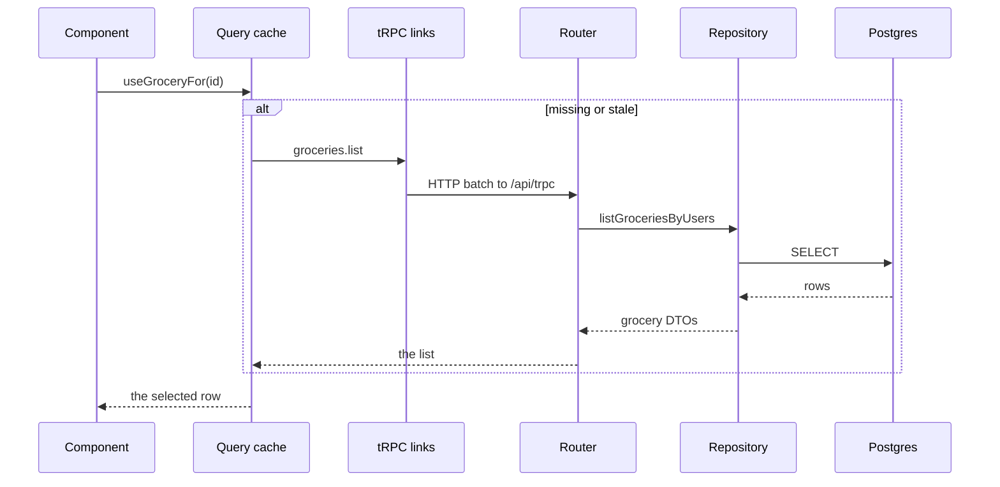
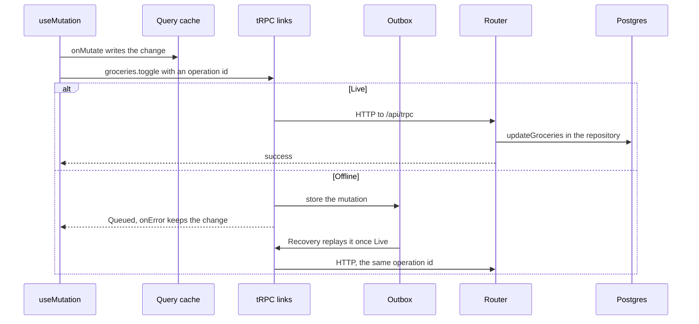
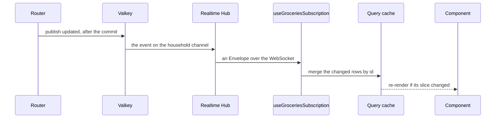

# Architecture

The Next.js web app and Expo mobile app use one Node server. tRPC queries and
mutations use HTTP. Realtime events use a WebSocket.

## Folder structure

```
norish/
├── apps/
│   ├── web/               # Next.js app, and the server entry in server/
│   ├── mobile/            # Expo app
│   ├── parser-api/        # Python service around recipe-scrapers
│   ├── docs/              # This site
│   ├── landing/           # norish.dev
│   └── quick-import-extension/  # Browser extension, a git submodule kept in its own repository
├── packages/
│   ├── api/               # Server startup, the import parser, CalDAV sync and video processing
│   ├── auth/              # Better Auth, sessions and permission checks
│   ├── config/            # Environment config and default reference data
│   ├── db/                # Repositories, migrations and the Drizzle client
│   ├── db-schema/         # Drizzle table definitions
│   ├── i18n/              # Locales and messages
│   ├── queue/             # Background jobs on BullMQ
│   ├── shared/            # Contracts and helpers that clients and server both import
│   ├── shared-react/      # React logic both apps share
│   ├── shared-server/     # Server logic several packages use: AI, realtime, ingredients, Valkey
│   ├── trpc/              # tRPC routers and the tRPC server
│   └── ui/                # Shared React components
├── tooling/
│   ├── eslint/            # Lint config, including the feature import rules
│   ├── prettier/          # Prettier config
│   ├── typescript/        # tsconfig files
│   ├── tailwind/          # Tailwind theme
│   ├── github/            # Composite GitHub Actions
│   ├── monorepo/          # Circular dependency and workspace import checks
│   ├── ingredient-icons/  # Draws the Ingredient Icons Norish ships
│   └── nutrition/         # Builds the nutrition source table
└── docker/                # Compose files and images
```

## What goes where

### In an app

Web uses the root of `apps/web`. Mobile uses `apps/mobile/src`.

- `app/` owns routes, layouts and loading states. Web routes also handle metadata,
  redirects and server-side reads for the first render.
- `features/<feature>/` owns the screens, components, hooks and helpers for a
  domain. For example, the Library owns cookbooks, and Calendar owns CalDAV.
  Settings tabs render screens from their owning features.
- Put feature tests in `features/<feature>/__tests__/`. Group feature components
  by area. Use an area's `index.ts` for components used by multiple screens.
  Import a component used by one screen directly to keep it out of other bundles.
- A feature can import app-wide code from `components/`, `hooks/` or `lib/`,
  depending on the app. Routes can import feature screens. Features cannot import each other.
  Put panels used by several web features in `components/Panel/consumers/`.
  Shared import UI lives in `components/imports/`.

For views with one layout, mount a root at the layout. For example,
`GroceriesRoot` owns the header and subscriptions for the grocery list and
Pantry. The route selects the view, and the layout seeds its first reads.

### In shared-react

Put shared domain hooks, stores and subscriptions in a folder such as
`packages/shared-react/src/groceries/`. Apps use
`@norish/shared-react/<domain>`. Tests live in `src/<domain>/__tests__/`.
CalDAV belongs to `calendar`. Import mutations belong to `recipes`.

| Folder        | What goes there                                                                        |
| ------------- | -------------------------------------------------------------------------------------- |
| `trpc/`       | Client links, providers and the shared `useTRPC` context.                              |
| `platform/`   | App adapters for navigation, toasts, errors, storage, device kind and session actions. |
| `offline/`    | Offline Cache, Outbox, Replay, Recovery and optimistic updates.                        |
| `config/`     | Reference data and sign-in provider queries.                                           |
| `reader/`     | Identity, account, household, permissions, Device Preferences and session cleanup.     |
| `realtime/`   | `useRealtimeSubscription` and `useKeepsCurrent`.                                       |
| `page-store/` | `createPageStoreContext` for stores scoped to a page key.                              |

A domain can import these shared folders. Lint forbids imports between domains
and imports from a shared folder into a domain.

### Contracts

Put types and Zod schemas used by both the clients and server in
`packages/shared/src/contracts/`. Realtime Catalogues live in
`contracts/realtime/`. Shared helpers, such as recurrence, live in `src/lib/`.

### On the server

- Put procedures in `packages/trpc/src/routers/<domain>/`. Validate inputs,
  check permissions and publish Realtime Events after writes. Put longer
  domain logic in a router helper or `packages/shared-server`.
- Put database queries in `packages/db/src/repositories/`. Routers call
  repositories for every database read and write.
- `apps/web/server/` starts the HTTP server in `packages/api`. It serves Next.js
  and attaches the tRPC WebSocket. `packages/api` also owns startup tasks,
  imports, CalDAV and video processing.
- `packages/queue` runs background jobs through handlers registered by
  `packages/api` at startup.

### The AI boundary

AI code lives under `packages/shared-server/src/ai/`.

- `runtime/` sends model requests. See [ADR-0015](https://github.com/norish-recipes/Norish/blob/main/docs/adr/ai/0015-norish-issues-every-model-request-through-one-runtime.md).
- `prompts/` loads prompts that admins can edit.
- `enrichment/` derives details such as allergens from stored recipes.
- `resolution/` matches names to catalogue entries.
- `providers/` lists the models a provider offers.

Recipe extraction belongs to the import pipeline in `packages/api/src/parser/`.
For model requests, call `ai/runtime/runtime.ts` with a prompt name and the
sections to append. See [ADR-0016](https://github.com/norish-recipes/Norish/blob/main/docs/adr/ai/0016-prompts-are-appended-to-never-interpolated.md).

## Decisions

See [App architecture in CONTRIBUTING.md](https://github.com/norish-recipes/Norish/blob/main/CONTRIBUTING.md#app-architecture)
for the full rules.

- Read and write server data with named shared-react hooks. The `restrictTRPC`
  rule forbids direct calls to `useTRPC` and `useTRPCClient` in both apps.
- Keep server data in TanStack Query. Offline mode persists that cache. Use
  `useState` for state owned by one component and Zustand for shared UI state.
  Page stores hold IDs and UI state and are created per page provider.
  See [ADR-0001](https://github.com/norish-recipes/Norish/blob/main/docs/adr/offline/0001-web-offline-is-a-persisted-query-cache.md).
- Use generated tRPC key builders and named constants for other keys. To
  invalidate all variants of an infinite query, use `pathKey()`.
- Keep rollback and settle callbacks in `useMutation` options so they run for
  every call. Mutations carry operation IDs for safe replay. Creates use
  client-minted IDs so queued edits can refer to the new record.
  See [ADR-0002](https://github.com/norish-recipes/Norish/blob/main/docs/adr/offline/0002-replay-idempotency-via-operation-id-middleware.md)
  and [ADR-0003](https://github.com/norish-recipes/Norish/blob/main/docs/adr/offline/0003-client-minted-entity-ids-on-create.md).
- Mount subscriptions with the UI that draws the data. The shell owns its own
  reads and subscriptions, the feature root owns its screens, and a panel owns
  its reads and subscriptions while open. Seed only reads needed for the first
  render.
- Use `useKeepsCurrent` to declare which queries a subscription keeps current.
  Fresh subscriptions reread their `liveQueryKeys` once live, including after
  lag. A reconnect can resume events from the bounded buffer.
  See [ADR-0032](https://github.com/norish-recipes/Norish/blob/main/docs/adr/realtime/0032-realtime-is-one-hub-one-catalogue-one-idiom.md)
  and [ADR-0034](https://github.com/norish-recipes/Norish/blob/main/docs/adr/realtime/0034-resume-is-a-bounded-buffer-not-a-guarantee.md).
- Web, mobile, shared-react and `packages/ui` use the React Compiler. Lint
  reports components or hooks it skips.

## How data flows

These examples follow a grocery list item.

### A read

`useGroceryFor(id)` selects a row from the grocery list query. If the list is
missing or stale, tRPC batches the request to `/api/trpc`. The
`groceries.list` procedure reads from the repository and returns the list to
the Query cache.



On a full page load, `QuerySeed` can run the read on the server without HTTP.
Offline, the Offline Cache supplies saved data.

### A write

`useGroceriesMutations()` exposes actions such as `toggleGroceries(ids, isDone)`.
`onMutate` updates the Query cache before the request. The server checks the
operation ID and household access, then writes through the repository and
publishes an event. `onError` rolls back a failed write.

Offline, a queued write keeps its local change. Recovery replays the Outbox
with the original operation IDs when the server is reachable.



### A realtime update

After committing the write, `groceries.publish("updated", ...)` validates the
payload, adds it to the Valkey Resume Buffer and publishes it. The server's
Realtime Hub sends the event to subscribers on the household channel.

`GroceriesRoot` mounts `useGroceriesSubscription`. Its handler merges event rows
into the Query cache by ID. It can apply the same event twice with the same
result, including on the client that made the change.


